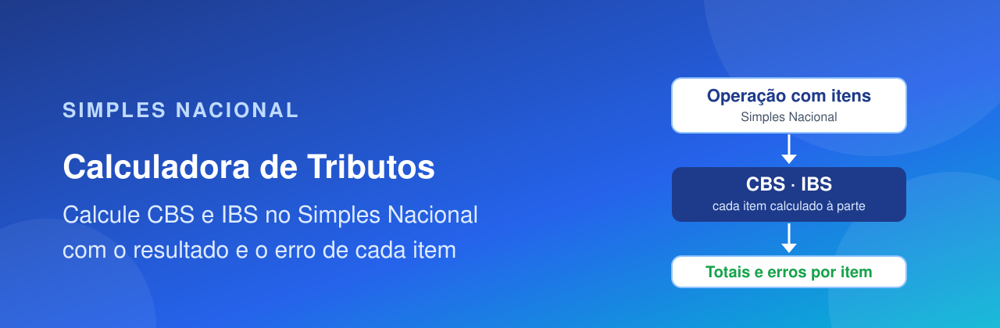

<p align="center">
  
</p>

<p align="center">
  <a href="https://github.com/nathanramorim/calculadora-rtc-simples-nacional/tags"></a>
  
  
  
  
</p>

<h3 align="center">Calcule CBS e IBS no Simples Nacional<br>com o resultado e o erro de cada item</h3>

---

## O que é

A Calculadora de Tributos do Simples Nacional é uma API que faz as contas de CBS e IBS da Reforma Tributária do Consumo (LC 214/2025) nas operações do regime do Simples Nacional. Você envia a operação com seus itens e recebe o resultado de cada um. Ela também consulta as atividades do Simples Nacional vigentes em uma data.

É mantida pela Receita Federal do Brasil, com o SERPRO. Faz par com a [calculadora do regime regular](https://github.com/nathanramorim/calculadora-rtc-regime-regular), da qual usa os scripts do banco de dados.

## Por que usar

| | |
|---|---|
| **Cálculo pronto** | CBS e IBS do Simples Nacional em uma chamada. |
| **Erro por item** | Um item com problema não impede o cálculo dos outros. Cada erro tem um código `VSN-` que você consulta na própria API. |
| **Atividades vigentes** | Consulta as atividades do Simples Nacional em uma data, com filtros por anexo, tipo de documento e cClassTrib. |
| **Mesma regra de arredondamento** | Usa a mesma classe de arredondamento do regime regular, para os números baterem entre as duas APIs. |
| **Documentação interativa** | Swagger com todos os campos e exemplos. |

## Antes de começar

- **Java 25**. Confira com `java -version`.
- **Git**, para baixar o projeto.
- **Internet** na primeira execução: o Maven Wrapper (`mvnw`) baixa o Maven sozinho, sem instalação.
- Windows, macOS ou Linux.

## Instalação

```bash
git clone https://github.com/nathanramorim/calculadora-rtc-simples-nacional.git
cd calculadora-rtc-simples-nacional
```

**Passo obrigatório: gerar o banco de dados.** Sem ele, a aplicação não inicia. Os scripts ficam no repositório da [calculadora do regime regular](https://github.com/nathanramorim/calculadora-rtc-regime-regular): copie a pasta `flyway/` de lá para a raiz deste projeto e rode:

Linux/macOS:

```bash
mkdir -p ./calculadora/db
./mvnw flyway:migrate -Dflyway.configFiles=./flyway/flyway-pro.conf --batch-mode --errors
```

Windows:

```bat
mkdir calculadora\db
mvnw.cmd flyway:migrate -Dflyway.configFiles=flyway\flyway-pro.conf --batch-mode --errors
```

Confirme que o arquivo foi criado com `ls -lah ./calculadora/db/calculadora-pro.db` (Linux/macOS) ou `dir calculadora\db\calculadora-pro.db` (Windows).

## Como usar

Inicie a aplicação:

```bash
./mvnw spring-boot:run -Dspring-boot.run.profiles=offline
```

No Windows: `mvnw.cmd spring-boot:run "-Dspring-boot.run.profiles=offline"`.

A API fica em `http://localhost:8082/api`, a documentação interativa em `http://localhost:8082/api/swagger-ui.html` e as métricas em `http://localhost:9103/metrics`.

| Para | Chamada |
|---|---|
| Calcular o Simples Nacional (erros por item) | `POST /api/calculadora/observabilidade/simples-nacional` |
| Entender um código de erro | `GET /api/calculadora/observabilidade/simples-nacional/erros?codigo=VSN-001` |
| Listar atividades vigentes numa data | `GET /api/calculadora/simples-nacional/atividades?data=AAAA-MM-DD` |
| Consultar uma atividade pelo código | `GET /api/calculadora/simples-nacional/atividades/{codigo}?data=AAAA-MM-DD` |
| Ver a versão da aplicação e da base | `GET /api/versao` |
| Comparar com a instalação online (só perfil `offline`) | `GET /api/versao/status` |

Exemplos de envio estão em [docs/exemplos.md](docs/exemplos.md).

Para rodar os testes e ver a cobertura (eles também precisam do banco gerado):

```bash
./mvnw clean test jacoco:report
```

O relatório fica em `target/site/jacoco/index.html`.

Para gerar o JAR e executá-lo:

```bash
./mvnw clean package
java -Dspring.profiles.active=offline -jar target/api-simples-nacional.jar
```

No Windows: `mvnw.cmd clean package` e `java "-Dspring.profiles.active=offline" -jar target\api-simples-nacional.jar`. Execute o JAR a partir da raiz do projeto, para que `./calculadora/db` seja encontrado.

## Segurança e privacidade

- A aplicação só lê o banco de dados. Ela nunca altera as tabelas oficiais.
- A configuração de segurança libera todas as rotas e o CORS aceita só as origens configuradas. Não exponha a API na internet sem revisar isso.
- Para relatar uma falha de segurança, veja [SECURITY.md](SECURITY.md).

## Versões

| Versão | Novidades |
|---|---|
| 1.0.2 | `ArredondamentoUtils` passa a ser a cópia única da política numérica, idêntica à do regime regular, com testes que impedem as duas de divergir. Os valores do Simples Nacional não mudaram. |
| 0.0.6 | Documentação exigida para publicação no GitHub da Receita Federal. |

O histórico completo está no [CHANGELOG](CHANGELOG.md).

## Para quem quer contribuir

Este repositório não aceita Pull Requests de fora. Sugestões e relatos de erro entram por Issues e Discussions. Veja o [guia de contribuição](CONTRIBUTING.md) e a [governança](GOVERNANCE.md).

## Referências

- [Code of conduct](https://www.contributor-covenant.org)
- [MIT license](https://choosealicense.com/licenses/mit/)
- [Keep a Changelog](https://keepachangelog.com/pt-BR/1.1.0/)
- [Semantic Versioning](https://semver.org/lang/pt-BR/)

## Licença

[MIT](LICENSE)
