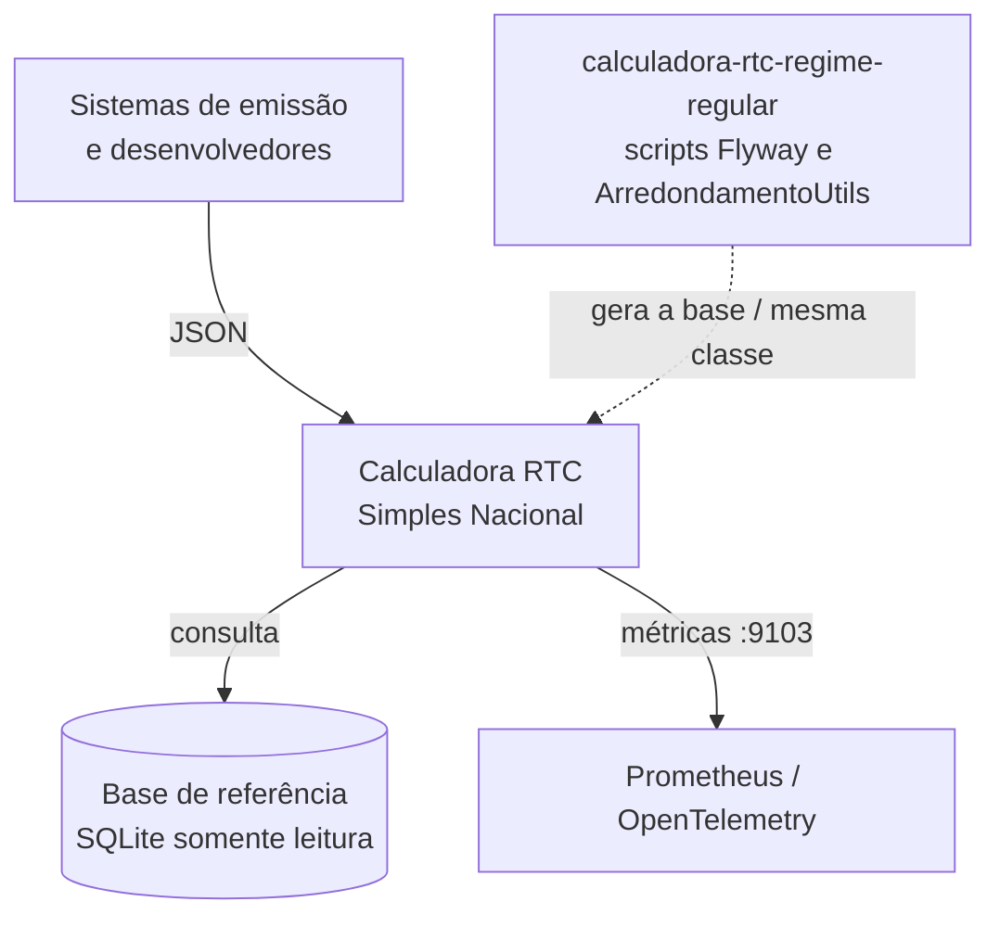
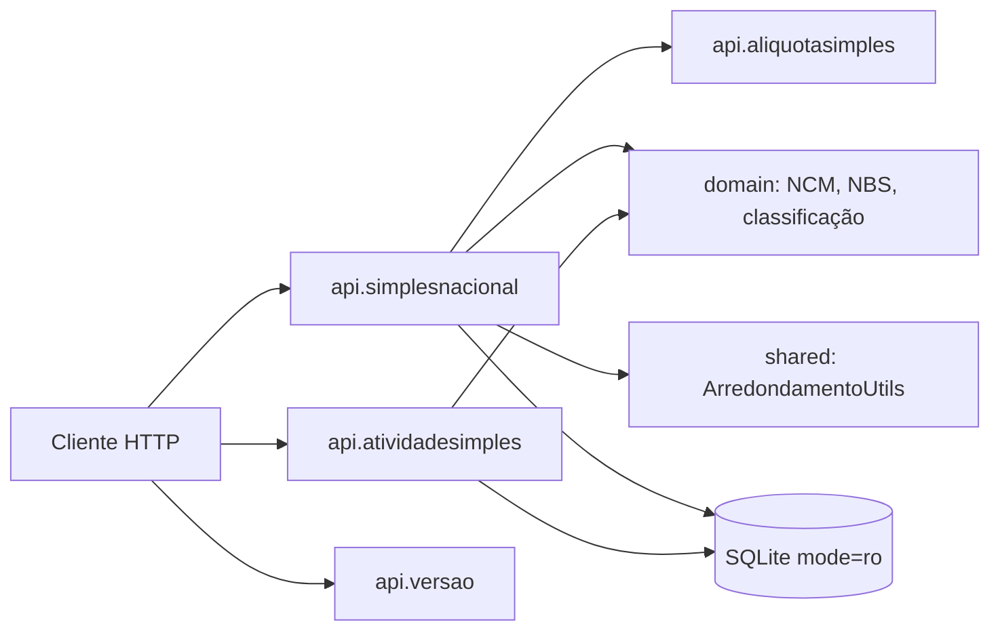

# Overview — calculadora-rtc-simples-nacional

API REST em Java 25 e Spring Boot 4, mantida pela Receita Federal e pelo SERPRO. Calcula CBS e IBS (LC 214/2025) nas operações do Simples Nacional, devolve erros por item e consulta as atividades vigentes. Usa o mesmo banco de referência (SQLite somente leitura) e a mesma política de arredondamento do `calculadora-rtc-regime-regular`.

## Índice
- `stack.md` — tecnologias e layout
- `modules.md` — componentes
- `flows.md` — fluxos principais
- `decisions.md` — decisões e índice de ADRs
- `concepts.md` — um conceito, uma casa (`DUP-01`)

---

## Arquitetura (C4 Model)

### Nível 1: Contexto

### Nível 2: Containers

